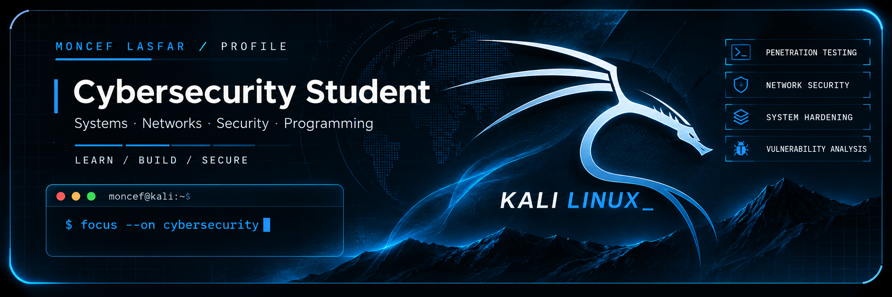
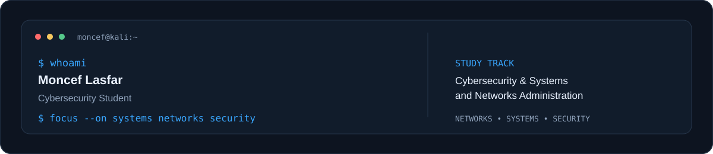

  

  <picture>
    <source media="(prefers-color-scheme: dark)" srcset="assets/profile-dark.svg">
    <source media="(prefers-color-scheme: light)" srcset="assets/profile-light.svg">
    
  </picture>

## About Me

I'm a second-year **Cybersecurity and Systems & Networks Administration** student interested in understanding how systems communicate, how networks are built, and how digital environments can be secured.

My studies combine programming fundamentals, computer networks, operating systems, and information security. I enjoy applying what I learn through practical projects and technical labs.

## Focus Areas

  
  
  
  

## Technical Skills

### Programming

  
  
  
  
  
  

### Networking

  
  
  
  

### Systems

  
  

### Security Tools

  
  
  
  

## Academic Background

**Year 2 · Cybersecurity and Systems & Networks Administration**

My curriculum includes:

| Area | Coursework |
|---|---|
| Networking & infrastructure | Networks, Advanced Networks & Virtualization, Computer Architecture |
| Systems | Operating Systems I & II, Systems & Networks Administration |
| Cybersecurity | Information Security, Security by Design, IT Security Governance |
| Cryptography | Cryptography & Blockchain |
| Programming | C, Python, C++, Java, Web Development |
| Data & engineering | Relational Databases, Database Programming, Data Mining, UML, Compilation |

*Coursework reflects the programme structure; practical tools above are listed from my own provided skills inventory.*

## Featured Project

  

**Patient Management System — C**

A menu-driven C application for managing patient records. It demonstrates structured programming, CRUD operations, searching, sorting, filtering, and local file handling.

- Create, view, update, and delete patient records.
- Search by patient number or last name.
- Sort records by last name and filter by blood group.
- Save and load records using a local text file.

[View repository and source code](https://github.com/Moncef-Lassfar/patient-management-system)

> Educational programming project only. It is not a production medical system. Use fictional data; do not publish real patient information.

## Currently Exploring

- Network configuration and troubleshooting
- Linux and Windows system administration
- Network traffic analysis and security testing in authorized labs
- Secure software and application fundamentals

## Connect

  

  Learn continuously. Build deliberately. Secure by design.

