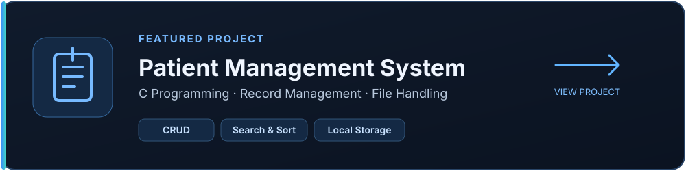

  

## Profile

I'm a second-year **Cybersecurity and Systems & Networks Administration** student. My studies cover programming, computer networks, operating systems, and information security. I use practical projects and technical labs to strengthen my understanding of how systems work and how they can be secured.

## Education

**Year 2 · Cybersecurity and Systems & Networks Administration**

Relevant coursework:
- **Networking:** Computer Networks, Advanced Networks & Virtualization, Computer Architecture
- **Systems:** Operating Systems I & II, Systems & Networks Administration
- **Security:** Information Security, Security by Design, IT Security Governance
- **Programming & Data:** C, Python, C++, Java, Web Development, Relational Databases, Data Mining, UML, Compilation
- **Cryptography:** Cryptography & Blockchain

## Technical Skills

### Programming

### Networking

### Systems

### Security Tools

## Featured Project

  

**Patient Management System — C**

A menu-driven application for managing patient records. The project demonstrates structured programming and basic data-management operations.

- Create, view, update, and delete records.
- Search by patient number or last name.
- Sort records by last name and filter by blood group.
- Save and load records using a local text file.

[**Explore the repository and source code →**](https://github.com/Moncef-Lassfar/patient-management-system)

> Educational project only — not a production medical system. Use fictional data; never publish real patient information.

## Contact

  

---

  Learn continuously. Build deliberately. Secure by design.

