  

  Second-year student in <b>Cybersecurity and Systems &amp; Networks Administration</b>. 
  I learn by building: practical projects and technical labs around systems, networks, and security.

  

## Featured Project

  

> Educational programming project only, not a production medical system. It uses fictional data.

## Technical Skills

| | |
|---|---|
| **Programming** |  |
| **Networking** |  |
| **Systems** |  |
| **Security tools** |  |

## Education

**Year 2 · Cybersecurity and Systems & Networks Administration**

| Area | Coursework |
|---|---|
| Networking & infrastructure | Networks, Advanced Networks & Virtualization, Computer Architecture |
| Systems | Operating Systems I & II, Systems & Networks Administration |
| Cybersecurity | Information Security, Security by Design, IT Security Governance |
| Cryptography | Cryptography & Blockchain |
| Programming | C, Python, C++, Java, Web Development |
| Data & engineering | Relational Databases, Database Programming, Data Mining, UML, Compilation |

## Currently Exploring

Network configuration and troubleshooting · Linux and Windows administration · Traffic analysis and security testing in authorized labs · Secure software fundamentals

  Learn continuously. Build deliberately. Secure by design.

